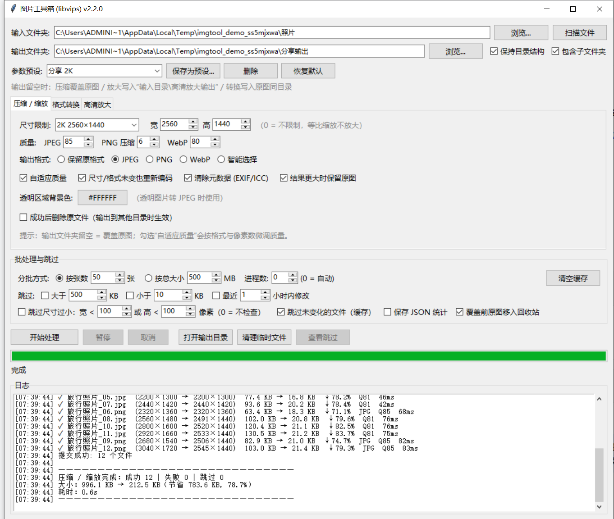

# 图片工具箱（libvips）


A batch image toolkit for Windows: compress, convert and upscale photos fast using
[libvips](https://www.libvips.org/), with a Tkinter GUI.

合并自多个零散的图片处理脚本（Wand / Pillow / libvips），统一为一个基于 libvips 的图形工具：
**压缩 / 缩放、格式转换、高清放大**。



## 功能

- **压缩 / 缩放**：按最大宽高等比缩放（不放大）；JPEG / PNG / WebP 分格式质量；
  自适应质量；智能输出格式（透明图/小图→PNG，其余→WebP）。
- **格式转换**：JPEG / PNG / WebP 互转，透明区域可自定义背景色。
- **高清放大**：1.0~4.0 倍 Lanczos3 插值放大，可选锐化强度。
- **安全写入**：先写同目录临时文件，再原子替换；覆盖前可将原图移入回收站（可还原）。
- **批量能力**：自动并行（进程池 + libvips 线程控制）、按张数/大小分批、
  暂停/取消、断点缓存（未变化的文件自动跳过）、JSON 统计报告。
- **格式支持**：JPEG、PNG、WebP、BMP、TIFF、GIF、HEIC/HEIF（通过 pillow-heif 解码）。
- **EXIF 方向自动纠正**，可选清除 EXIF/ICC 元数据。

## 参数预设

内置四套，可在界面顶部直接切换：

| 预设 | 参数 | 用途 |
|---|---|---|
| 归档 4K | 3840×2160 / JPEG / Q85 | 长期保存，兼容性最好 |
| 分享 2K | 2560×1440 / JPEG / Q85 / 自适应 | 清晰度与体积平衡 |
| 社交 1080p | 1920×1080 / JPEG / Q85 / 自适应 | 聊天、社交 |
| 省空间 4K（SMART） | 3840×2160 / 智能选择 | 网盘、网页，体积最小 |

## 环境要求

- Windows 10/11
- Python 3.10+（开发与测试使用 3.12）

## 安装

```bat
:: 1. 安装依赖
python -m pip install -r requirements.txt

:: 2. 安装 libvips（pyvips 需要本机 libvips 动态库）
::    下载 Windows 版并解压后，把 bin 目录加入 PATH：
::    https://github.com/libvips/libvips/releases
```

`pillow-heif` 用于解码 HEIC（libvips 的 libheif 常缺少 HEVC 解码器）。

## 使用

```bat
:: 方式一：双击
启动.bat

:: 方式二：命令行
python main.py
```

1. 选择输入文件夹（输出文件夹留空则写回源目录，见下方说明）。
2. 选择模式（压缩 / 转换 / 放大）与参数，或直接选预设。
3. 点“开始处理”。

**输出文件夹留空的含义**

| 模式 | 行为 |
|---|---|
| 压缩 + 保留原格式 | 覆盖原图（先写临时文件再原子替换） |
| 压缩 + 智能选择 | 同目录生成新格式，默认保留原图 |
| 格式转换 | 同目录生成新格式，默认保留原图 |
| 高清放大 | 写入“输入目录\高清放大输出” |

输入/输出文件夹不会被记忆，每次启动需要重新选择。

## 项目结构

```
DS_libvips/
├── main.py            # 入口
├── core/              # 处理逻辑（可脱离 GUI 复用）
│   ├── processor.py   # libvips 读取/缩放/放大/保存/提交
│   ├── models.py      # TaskSettings / SkipPolicy / ImageResult
│   ├── cache.py       # 处理缓存
│   ├── preferences.py # 参数记忆与预设
│   ├── backup.py      # 回收站备份
│   ├── stats.py       # JSON 统计
│   └── utils.py       # 扫描、分批、颜色、并行度
├── gui/
│   ├── app.py         # 主窗口
│   ├── panels.py      # 三个模式的参数面板
│   └── presets.py     # 内置预设
├── tests/smoke_test.py
└── docs/              # 截图与测试报告
```

## 测试

```bat
python tests\smoke_test.py
```

覆盖核心处理、三种模式 GUI、参数记忆/预设、目录不记忆等。

## 实测数据

- 362 张 JPEG / 3.24 GB，默认智能选择：73.1 s 完成，输出 308 MB（降幅 90.7%），0 失败。
- 详细报告：[真实照片验收报告](docs/真实照片验收报告.md)、[压力测试报告](docs/压力测试报告.md)。
- 合并分析与功能对照：[合并说明.md](合并说明.md)。

## 说明

本仓库由作者本机使用的多个图片处理脚本合并而来，界面与文档为中文。

## 许可证

[MIT License](LICENSE) © 2026 Ray920501

可自由使用、修改、分发和商用，仅需保留版权与许可声明。软件按“现状”提供，不附带任何担保。
