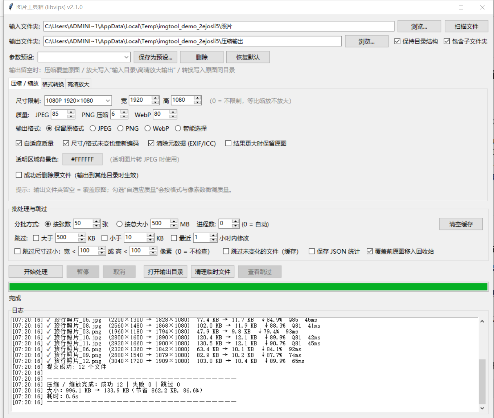

# 图片工具箱（libvips）——分析与合并说明

本目录原本是 `DS_libvips.py` 拆分出的 libvips 压缩工具；本次把 `D:\Python\图片`
下另一批功能相近的脚本（Wand / Pillow / libvips 混合）全部读完，分析差异后合并为
**一个三模式的图形化工具**：压缩/缩放、格式转换、高清放大。

所有旧脚本保持原样未改动（`D:\Python\图片` 下的文件不会被动），本目录是合并后的新版本。



---

## 一、旧脚本清单与处置

| 旧脚本 | 技术栈 | 主要能力 | 处置 |
|---|---|---|---|
| `DS_libvips.py` | pyvips | 压缩/缩放、输出目录、分批、原子替换、JSON 统计、进程池 | **作为架构骨架**，保留并修复已知 bug |
| `DS图片.py` | Wand（Pillow 兜底） | 五段跳过策略（大小/格式/完整性/尺寸/修改时间）、跳过清单、批次确认、PNG 配置文件清理 | 跳过策略与“查看跳过”合并进来 |
| `DS图片整合25.py` | Wand（Pillow 兜底） | `DS图片.py` 的删减分支（少了尺寸/完整性/时间检查） | 无独有功能，不单独保留 |
| `deepseek_图片.py` | Wand（Pillow 兜底） | 在整合25 基础上增加 PNG→JPG、透明背景处理、失败清理临时文件 | 转换为独立“格式转换”模式 |
| `png转换.py` | Pillow | PNG→JPG，递归、输出目录、转换后询问删除源文件 | 合并进“格式转换”模式 |
| `PNG 批量转 JPG .py` | Pillow | 类似 PNG→JPG，质量滑杆、默认输出目录 | 合并进“格式转换”模式（功能重叠） |
| `优化文件.py` | Wand + 线程池 | 记录缓存（mtime+参数哈希）、按文件数/平均大小动态线程数、PNG 配置清理 | 缓存与并行度启发式合并进来 |
| `压缩图片_2508.py` | Wand + 线程池 | 在优化文件基础上增加 SSD/HDD 检测 | 缓存保留；SSD 检测未合并（见第五节） |
| `自适应压缩.py` | Wand，命令行 | 按目标宽度缩放 + 统一质量、覆盖原文件 | 压缩模式的“目标宽度 + 质量”来源 |
| `自适应高速.py` | Wand，多进程 | 自适应质量算法（按格式/像素数微调） | 算法移植到 `core/processor.py` |
| `图形界面.py` | Wand | 基础压缩 GUI（宽度四档 + 质量 + PNG 配置） | 被 `DS图片.py` 覆盖，不单独保留 |
| `文件夹.py` | Wand | 基础压缩 GUI + 递归 | 同上 |
| `DS放大.py` | Wand | 放大（倍数 + 锐化半径/强度）、删除原文件、打开输出目录 | 合并为“高清放大”模式 |
| `放大.py` | Wand | 简化版放大（无删除、无输出目录选择） | 被 `DS放大.py` 覆盖 |
| `覆盖原文件.py` | Wand，命令行 | 目标宽度压缩并覆盖原文件 | 压缩模式默认“覆盖原图”语义 |
| `批量图像尺寸调整器.py` | Pillow，命令行 | 按目标宽度等比缩放、保持/不保持比例、覆盖已存在文件 | 尺寸预设 + “仅缩放”能力 |

---

## 二、合并后的结构

```
DS_libvips/
├── main.py                     # 程序入口（DPI 适配 + 进程池 freeze_support）
├── 启动.bat                    # 双击启动（pythonw，无控制台窗口）
├── core/                       # 纯逻辑，可被 GUI/命令行复用
│   ├── enums.py                # OutputFormat / BatchMode / OperationMode
│   ├── constants.py            # 扩展名、尺寸预设、质量与缓存默认值
│   ├── models.py               # SkipPolicy / TaskSettings / ImageResult
│   ├── processor.py            # libvips 读取、缩放/放大、自适应质量、保存、提交
│   ├── cache.py                # 已处理文件缓存（mtime+大小+参数指纹）
│   ├── preferences.py          # 参数记忆与命名预设
│   ├── backup.py               # 覆盖前把原图移入回收站（可还原）
│   ├── stats.py                # JSON 统计报告（含逐文件明细）
│   └── utils.py                # 扫描、分批、颜色解析、并行度、临时文件清理
├── gui/
│   ├── app.py                  # 主窗口：目录、批处理、日志、进度、提交、取消
│   └── panels.py               # 三个模式的参数面板
└── tests/
    └── smoke_test.py           # 端到端冒烟测试（核心 + 三模式 GUI）
```

---

## 三、功能对照表

| 功能 | 旧来源 | 新位置 | 说明 |
|---|---|---|---|
| 最大宽/高、等比缩放不放大 | DS_libvips | `processor.calculate_target_size` | 支持任意宽高，0 = 不限制 |
| 宽度快捷档 1920/2160/2560/3840 | DS图片 / 自适应压缩 | 压缩面板“尺寸限制”下拉框 | 另加 1080P/2K/4K 组合与“自定义” |
| 分格式质量（JPEG/PNG/WebP） | DS_libvips | `TaskSettings` + 压缩面板 | PNG 使用 0~9 压缩级别（修正旧版 9-q 反比映射） |
| 输出格式 keep/jpeg/png/webp/smart | DS_libvips | 压缩面板 | 默认改为“保留原格式”；smart 按 alpha/小图选择 |
| 自适应质量 | 自适应高速.py | `processor.adaptive_quality` | 按源格式系数 + 像素数系数微调，且不超过用户设定值 |
| 结果更大时保留原图 | 新增（旧版无） | 压缩面板选项 | 同格式重编码变大时丢弃结果，避免“越压越大” |
| PNG 颜色配置清理 | DS图片 / 优化文件 | “清除元数据 (EXIF/ICC)” | libvips 用 `strip=True` 一次性去掉 EXIF/ICC/XMP |
| EXIF 方向自动旋转 | 旧版均未处理 | `processor._read_image` | 先 `autorot()` 再 strip，避免照片方向错乱 |
| 透明背景色 | deepseek_图片（固定白底） | 压缩/转换面板颜色选择器 | 支持任意颜色，默认白色 |
| PNG→JPG / 任意格式转换 | png转换 / deepseek_图片 | 格式转换模式 | 不改变分辨率；同目录或指定输出目录 |
| 高清放大（倍数 + 锐化） | DS放大 / 放大 | 高清放大模式 | Lanczos3 + libvips `sharpen`，默认输出“高清放大输出” |
| 删除原文件 | DS放大 / deepseek_图片 | 三个面板的复选项 | 必须提交成功后才会删除，并有确认弹窗 |
| 覆盖原图（输出目录留空） | 各旧版 | 压缩模式默认 | 先写临时文件再 `os.replace`，中途失败不损坏原图 |
| 输出目录 + 保持目录结构 | DS_libvips | 顶部目录区 | 转换/放大/压缩共用 |
| 递归扫描 | DS图片 / 优化文件 | 顶部“包含子文件夹” | 默认开启 |
| 跳过大于/小于指定大小 | DS_libvips（单阈值） | 高级区 | 修正为两个独立阈值（旧版共用一个字段） |
| 跳过最近修改 | DS图片 | 高级区 | 支持 1~720 小时 |
| 跳过尺寸过小的图片 | DS图片 | 高级区 | 只读图片头，不完整解码 |
| 跳过未变化的文件（缓存） | 优化文件 / 压缩图片_2508 | `core/cache.py` | 指纹含 mtime、大小、全部处理参数、输出目录；输出被删会自动失效 |
| 按张数 / 按总大小分批 | DS_libvips | 高级区 | 生成器实现，单文件超限时独占一批 |
| 暂停 / 继续 / 取消 | DS_libvips | 主窗口按钮 | 暂停在批次边界生效；取消会清掉未提交的临时文件 |
| 自动并行度 | 优化文件 / 压缩图片_2508 | `utils.recommend_workers` | 按 CPU 核数、文件数、平均大小计算；可手动指定进程数 |
| 临时文件 + 原子替换 | DS_libvips | `processor.commit_results` | 临时文件带真实后缀（修复旧版 .tmp 导致 TIFF/BMP 保存失败） |
| 残留临时文件清理 | DS_libvips | `utils.cleanup_orphan_temps` | 扫描时清理 24 小时前的残留，另有手动清理按钮 |
| 跳过清单查看 + 复制 | DS图片 | “查看跳过”按钮 | 记录本次所有跳过原因，可复制到剪贴板 |
| JSON 统计报告 | DS_libvips（无逐文件） | `core/stats.py` + 高级区勾选 | 含设置、汇总、逐文件明细 |
| 打开输出目录 | DS放大 | 主窗口按钮 | 运行结束后自动启用 |
| HEIC/HEIF | 旧版均不支持 | `processor.load_image` | 优先用 libvips `heifload`，失败时回退 FFmpeg 解码 |
| 输出名冲突处理 | 旧版无（deepseek 会静默覆盖） | `app._execute_task` 预判 | 例如 `a.png` 与 `a.webp` 都转 `a.jpg` 时自动改名 |
| 参数记忆 / 命名预设 | 新增（旧版无） | `core/preferences.py` + 顶部“参数预设” | 启动自动恢复上次参数；最多 20 套命名预设；保存于 `~/.image_toolkit_settings.json` |
| 覆盖前备份原图 | 新增（旧版无） | `core/backup.py` + 高级区勾选 | 默认开启；本地盘移入回收站（可还原），网络盘复制到 `.originals`；备份失败则跳过该文件 |

---

## 四、合并时修复的旧问题

1. **同路径早退**：`DS_libvips.py` 在“输出目录为空 + 保持原格式”时直接返回成功，
   实际什么都没做。新版默认始终重新编码，并提供“尺寸/格式未变也重新编码”开关。
2. **大小写扩展名误删输出**：旧版对 `A.JPG → A.jpg` 用大小写敏感路径比较，会把刚写好的
   文件删掉。新版统一用 `os.path.normcase(os.path.abspath(...))` 比较。
3. **`.tmp` 后缀导致非 JPEG/PNG/WebP 保存失败**：临时文件改为保留真实扩展名
   （`a.tif.tmp1234.tif`），libvips 能正确选择保存器。
4. **`future.result()` 调用两次**：旧 GUI 里第一次 `try/except` 的结果被第二次调用覆盖，
   异常分支形同虚设。新版只调用一次。
5. **后台线程异常导致界面永久禁用**：新版 `_run_task` 有兜底 `try/except`，无论发生什么
   都会回传 `done` 恢复按钮。
6. **worker 直接操作 Tk 控件**：新版后台线程只写队列，所有控件操作都在主线程轮询里完成。
7. **`verify()` + `load()` 全量误判损坏**：旧 `DS图片.py` 因此默认跳过所有图片。新版不做
   预检查，真正解码失败时按文件报错，不会误跳。
8. **非原子覆盖**：旧版 `shutil.move` 覆盖原图；新版同目录临时文件 + `os.replace`。
9. **失败分支不清理临时文件**：新版保存异常时立即删除临时文件，取消时统一清理。
10. **统计保存的运算符优先级 bug**：`(A or B) if image_files else "."` 在新版重写。
11. **进程池 × libvips 线程超订**：新版按进程数设置 `VIPS_CONCURRENCY`，避免 N×CPU 线程。
12. **暂停后仍提交当前批次 / 取消后进度条显示 100%**：新版取消不提交、不置 100%。

---

## 五、有意未合并的部分

| 旧功能 | 不合并原因 |
|---|---|
| SSD/HDD 检测（压缩图片_2508.py） | 依赖的 `wmic` 在 Windows 11 已移除，且 libvips 是 CPU 密集型，存储类型对并行度影响很小；改用自适应并行度 |
| 批次间隔 `sleep`、批次间确认弹窗（DS图片.py） | 是为 Wand 内存/句柄问题设计的；新版的“暂停/继续”已覆盖该需求，且不阻塞界面 |
| 跳过损坏图片预检查 | 需要额外完整解码一遍，代价高且旧实现有全量误判 bug；新版在真正处理时报告具体错误 |
| Wand / Pillow 双后端 | 合并后统一用 libvips，速度更快、依赖更少；旧版两后端结果不一致的问题随之消失 |
| TXT 统计（DS图片系） | 由字段更全的 JSON 统计替代 |
| 单文件命令行的交互式提问（批量图像尺寸调整器.py 等） | 能力已进入 GUI；如需命令行可再基于 `core` 封装 |

---

## 六、使用方式

环境：Python 3.12 + `pyvips`（本目录 `.venv` 已安装，libvips 8.18；依赖见 `requirements.txt`）。

```bat
:: 方式一：双击 启动.bat（无控制台窗口）
:: 方式二：命令行
.venv\Scripts\python.exe main.py
```

三种模式：

1. **压缩 / 缩放**：设定最大宽高（或选 1080P/2K/4K）、质量与输出格式；输出目录留空则覆盖原图。
   勾选“自适应质量”会按格式与像素数微调质量；“结果更大时保留原图”可避免重编码后变大。
2. **格式转换**：选目标格式（JPEG/PNG/WebP）与质量，可设置透明区域背景色；不改变分辨率。
3. **高清放大**：1.0~4.0 倍 Lanczos3 放大，可选锐化强度；输出目录留空时写入
   `输入目录\高清放大输出`。

常用选项：

- **输出目录留空**：压缩 = 覆盖原图；放大 = 自动子目录；转换 = 原图同目录。
- **删除原文件**：默认关闭，勾选后启动前会二次确认，且只有提交成功才会删除。
- **跳过未变化的文件（缓存）**：记录在 `%USERPROFILE%\.image_toolkit_cache.json`，
  修改参数或删除输出后会自动重新处理；可用“清空缓存”按钮重置。
- **查看跳过**：运行结束后可查看本次所有跳过原因并复制。
- **参数预设**：顶部“参数预设”可保存多套配置（最多 20 套），下拉选择后立即应用；
  “恢复默认”只重置参数、保留输入/输出目录。上次使用的参数会自动记忆到
  `%USERPROFILE%\.image_toolkit_settings.json`。
- **覆盖前备份**：默认勾选。本地磁盘上会把原图移入回收站（可在资源管理器还原）；
  网络盘、可移动盘或回收站不可用时，改为复制到图片旁边的 `.originals` 目录。
  如果备份失败，该文件会被跳过而不是直接覆盖。

---

## 七、测试

```bat
.venv\Scripts\python.exe tests\smoke_test.py
```

覆盖内容：

- 核心：压缩（KEEP/自适应质量）、智能格式、PNG→JPG（透明背景）、放大（尺寸校验）、
  原地覆盖 + 删除源文件、缓存命中/失效、输出名冲突改名。
- GUI：三种模式各跑一轮，检查输出文件与尺寸，验证按钮状态与日志。
- 参数记忆/预设：写入后重新加载、预设应用/删除。
- 备份：回收站调用成功、提交前触发备份、备份失败时跳过。
- 边界用例（已在开发时验证）：16-bit PNG→JPEG、EXIF orientation 自动旋转、
  TIFF/GIF/BMP 读取与保存回退、压缩后变大保护。

> 说明：HEIC 解码优先走 libvips；当前构建的 libheif 没有 HEVC 编码器，因此无法在本机
> 生成 HEIC 测试文件，解码失败时会自动回退到系统 `ffmpeg`（若已安装）。
